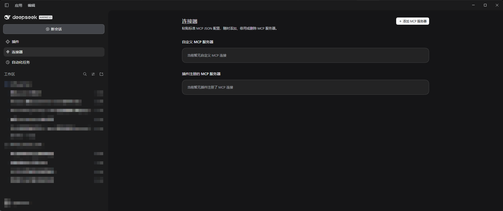
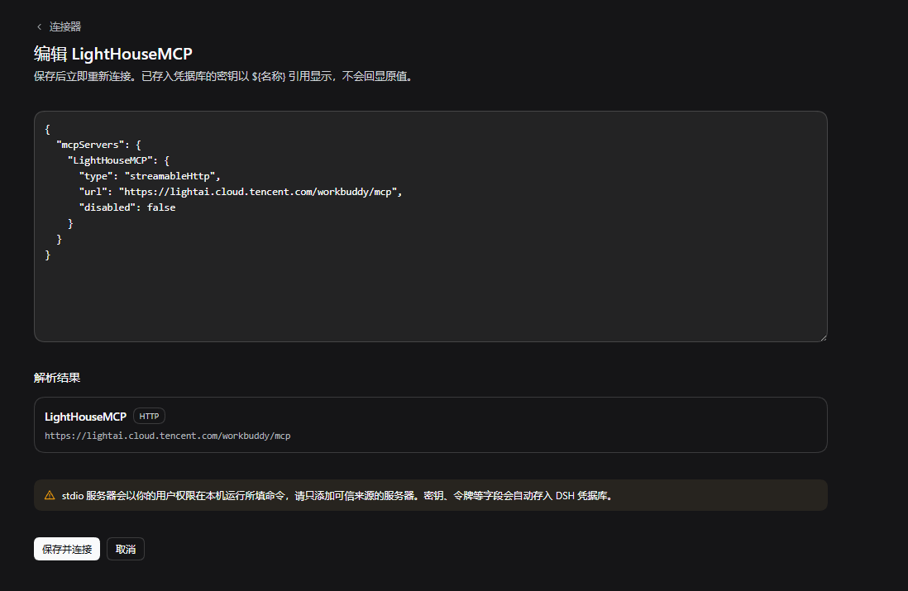
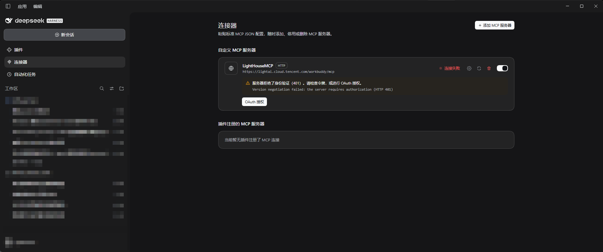
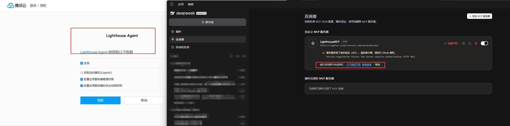
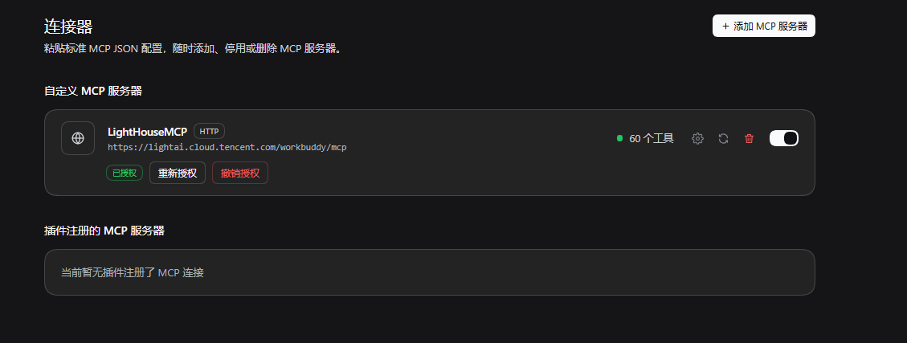

# 连接器（自定义 MCP）

中文 · [English](README.en.md)

在 DSH 左侧栏新增 **连接器** 页面：粘贴标准 MCP JSON，即可随时添加、停用、重新连接或删除 MCP 服务器，并查看每个服务器的连接状态与工具数量。插件版本 **1.0.1**，支持 **DSH 0.2.1-rc.2**。

实际的 MCP 协议、工具注册与子进程回收由 DSH 内置的官方 `@deepseek-ai/dsh-mcp-client` 负责；本插件为每个服务器挂载一个官方客户端实例，并提供管理界面。工具以 `mcp__<服务器名>__<工具名>` 注册，连接成功后从下一次模型请求起可用。

## 安装

在 DeepSeek Harness 打开 **插件 → 添加插件**，填入仓库地址：

```text
https://github.com/ApakohZzz/dsh-custom-json-mcp
```

也可以使用 `github:ApakohZzz/dsh-custom-json-mcp`；需要固定版本时在地址后加 `#v1.0.1` 这样的标签。DSH Web 版可运行：

```sh
dsh plugin --profile web add https://github.com/ApakohZzz/dsh-custom-json-mcp
```

安装后启用插件，左侧栏出现 **连接器**；升级到新版本后请按宿主提示重启 DSH。

## 页面



- **添加 MCP 服务器**：打开配置页，粘贴 JSON，实时显示解析结果、错误与将要存入凭据库的密钥。可一次添加多个服务器。
- **自定义 MCP 服务器**：在本页添加的服务器。每行提供编辑（齿轮）、重新连接、删除（两次确认）与启停开关。已连接时显示绿点和激活的工具数；连接失败时显示闪烁红点，并用警告框给出原因和处理建议。
- **插件注册的 MCP 服务器**：其他插件（如腾讯云服务器 MCP）挂载的 MCP 连接，只读展示。HTTP 服务器提供 **OAuth 授权** 按钮。两个分组各自显示在一块底板上，没有服务器时底板内显示“当前暂无”提示。

点击齿轮打开预填的配置页，修改后保存即重新连接；已存入凭据库的密钥只以 `${名称}` 引用显示：



## 支持的 JSON

```json
{
  "mcpServers": {
    "filesystem": {
      "command": "npx",
      "args": ["-y", "@modelcontextprotocol/server-filesystem", "C:/Users/me/Documents"]
    },
    "remote": {
      "type": "http",
      "url": "https://example.com/mcp",
      "headers": { "Authorization": "Bearer ${MY_MCP_TOKEN}" }
    }
  }
}
```

- 顶层可以是 Claude Desktop / Cursor / Windsurf / Claude Code `.mcp.json` 的 `mcpServers`、VS Code `mcp.json` 的 `servers`、VS Code 设置中的 `mcp.servers`，或直接的“名称 → 配置”映射；支持 JSONC 注释与尾逗号。
- 本地命令：`command`、`args`、`env`、`cwd`；远程服务：`type: "http"`、`"streamable-http"` 或 `"streamableHttp"`，`url`（也接受 `httpUrl`、`serverUrl`）与 `headers`。
- 可选字段：`disabled` / `enabled`、`toolCallTimeoutMs`（1000–3600000），以及 HTTP 服务器的 `oauth.clientId`、`oauth.clientSecret`、`oauth.scope`（或 `scopes`）、`oauth.callbackPort`。
- 服务器名称只能包含字母、数字、`-`、`_`，最多 32 个字符，且不能与其他插件的 MCP 服务器重名。
- 不支持：SSE 传输（可改用 Streamable HTTP 地址，或通过 `mcp-remote` 以本地命令连接）、`envFile`、VS Code 的 `inputs` 与 `${input:…}`、`${workspaceFolder}` 等编辑器变量。不支持的字段会被逐条报错或标为忽略，不会被悄悄丢弃。

## 凭据

- `${NAME}`、`${env:NAME}` 与 `${NAME:-默认值}` 从 DSH 凭据服务解析（存储值优先，其次是启动 DSH 的环境变量）；`${userHome}` 与 `${pathSeparator}` 也可使用。缺少的凭据可在配置页直接填写。
- 粘贴的明文密钥会在保存时自动移入 DSH 凭据库，配置中只保留 `${MCP_<服务器>_<字段>}` 引用：名称含 KEY / TOKEN / SECRET / PASSWORD / AUTH 等的 `env` 与 `headers` 值、`--api-key xxx` 或 `--token=xxx` 形式的参数、`mcp-remote` 的 `--header "Authorization: Bearer xxx"`，以及 URL 中的 `?api_key=` 等查询参数。删除服务器时一并移除这些自动生成的凭据。
- DSH 启动 stdio 子进程时会去掉继承环境中名称含 KEY / TOKEN / SECRET / PASSWORD 的变量，因此服务器需要的密钥必须写在 `env` 中（可使用 `${NAME}` 引用）。
- 编辑页面不会回显任何已保存的密钥。

## OAuth 授权

对未配置 `Authorization` 请求头的 HTTP 服务器，可点击 **OAuth 授权**：插件按 MCP 授权规范发现授权服务器（RFC 9728 / RFC 8414），在需要时动态注册客户端（RFC 7591），使用 PKCE 与 `resource` 参数在系统浏览器中完成授权，回调地址为本机 `http://127.0.0.1:<端口>/callback`。令牌作为 DSH 凭据记录保存，到期前自动刷新，授权完成后服务器自动重新连接。

以腾讯云 Lighthouse 的 MCP 服务为例，完整流程如下：

1. 服务器要求身份验证时，该行显示连接失败（401），并给出 **OAuth 授权** 按钮。

   

2. 点击后在系统浏览器打开授权页；页面行内同时提供“打开授权页面”和“复制链接”，浏览器没有自动打开时可手动访问。

   

3. 授权完成后服务器自动重连，显示已授权与激活的工具数；可随时重新授权或撤销授权。

   

- 授权服务器不支持动态注册时，请在 JSON 中填写预先注册的 `oauth.clientId`（以及需要的 `oauth.clientSecret`、`oauth.callbackPort`）。
- 插件注册的服务器授权后，本插件只为该 MCP 连接补充 `Authorization` 请求头，不修改原插件配置；撤销授权即恢复原状。
- 要求授权服务器使用 HTTPS（本机地址除外）。

## 安全

- 添加 stdio 服务器等同于允许以你的用户权限在本机运行该命令，请只添加可信来源的服务器。
- 管理操作只开放给 DSH 已登录的本机页面（宿主的 Host/Origin 校验与浏览器认证），不向模型提供增删服务器的工具。
- 服务器定义写入当前 profile 的 `cordis.patch.yml`（经 DSH 设置服务），密钥写入 DSH 凭据库。

## 已知限制

- 状态读取依赖官方客户端的公开行为：断线重连状态来自其日志，工具数来自工具注册表。
- 仅支持 MCP 工具；资源由 DSH 内置的 MCP 资源工具提供，提示词模板不受支持（与官方客户端一致）。
- 正在执行的模型请求不会中途获得新工具；连接或断开后，工具变化从下一次请求起生效。

## 开发

插件本体不需要构建。回归测试使用锁定版本的真实 Cordis、DSH 设置服务与官方 MCP 客户端，配合本地 stdio / HTTP 测试服务和本地 OAuth 授权服务器；依赖只安装在 `dev/`，不进入插件包。

```sh
npm ci --prefix dev --ignore-scripts
node tools/generate-icon.mjs --check
node tools/validate.mjs --check-source
node --test 'test/*.test.mjs'
```

`--check-source` 会联网下载固定提交的 Boxicons 原始文件逐字节比对；离线时省略该参数。本地调试不要直接添加仓库目录，而是先复制 `npm pack` 包含的文件到独立目录，并在其中执行 `npm install --omit=dev --ignore-scripts` 安装运行依赖，再在插件管理中添加该目录的绝对路径。分发内容变化须推进 `package.json` 版本。

## 来源与许可

自有代码采用 [MIT](LICENSE)。图标使用 [Boxicons](https://github.com/box-icons/boxicons-core) 的原始 `bx-mcp` 图形，原始 SVG 字节、固定提交与 SHA256 见 [upstream.json](upstream.json)，随包保留上游 [MIT 许可证](upstream/LICENSE)；`icon.png` 由 [`tools/generate-icon.mjs`](tools/generate-icon.mjs) 确定性派生。MCP 名称与标识归其权利人所有；截图为本插件运行界面，其中出现的 DeepSeek Harness、腾讯云等第三方页面与标识归各自权利人所有。本项目为社区插件，与 DeepSeek 无隶属或背书关系。
